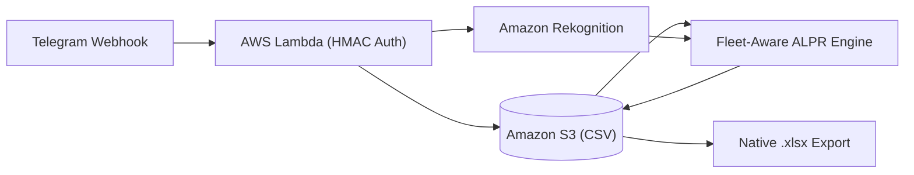

# Carvo - Serverless Fleet ALPR & Tracking Bot

[](https://github.com/onurvatansever/carvo-plate-tracker/actions/workflows/ci.yml)


Fleet car wash operations typically rely on manual paper logs or spreadsheets to track hundreds of daily vehicles, leading to human error, duplicate entries, and billing disputes. **Carvo** eliminates manual tracking: staff simply send a photo of the vehicle to a Telegram bot, which automatically extracts the license plate, cross-references it against historical fleet data, prevents same-day duplicates, and generates ready-to-bill `.xlsx` reports on AWS S3.



## Technical Highlights

- **Fleet-Aware Fuzzy OCR:** Uses historical wash records from S3 (`yikama_takip.csv`) and a custom visual confusion matrix (`B<->8`, `D<->0`, `M<->N`, `S<->5`) to auto-correct OCR errors caused by water, foam, glare, and mounting bolts.
- **Partition Parser & Spatial Filtering:** Evaluates all valid `(province, letter, number)` splits without greedy regex bugs, merges 2-line square plates, and filters out small background/frame text using `BoundingBox.Height`.
- **Zero-Dependency `.xlsx` Builder:** Generates valid Office Open XML spreadsheets in memory using Python's standard `zipfile` module (no `pandas` or `openpyxl`).
- **Stateless Webhook Security:** Authenticates requests via constant-time `hmac.compare_digest` (`X-Telegram-Bot-Api-Secret-Token`) and handles 1-click undo/swap callbacks without external state tables.

## Commands

| Command | Description |
| :--- | :--- |
| Photo | Reads the license plate, validates against fleet history, and logs it for today |
| `/bugun` | Lists all vehicles washed today along with the daily total |
| `/excel` | Exports the full multi-day wash tracking matrix as an `.xlsx` file |
| `/ekle 34ABC123` | Manually logs a license plate |
| `/sil` / `/sil 34ABC123` | Removes the last added plate or a specific plate from today's list |
| `/id` | Returns the current Telegram Chat ID for initial access setup |

## Tests

```bash
python -m unittest discover -s tests -v
```

---

## Türkçe Özet

Filo oto yıkama operasyonlarında gün içinde yıkanan yüzlerce aracın kağıt veya elle tutulan listelerle takip edilmesi; yanlış plaka yazımı, mükerrer kayıtlar ve ay sonu mutabakat sorunlarına yol açar. **Carvo**, bu süreci tamamen otomatikleştirir: personel yıkadığı aracın fotoğrafını Telegram botuna gönderir; sistem plakayı otomatik okur, geçmiş filo kayıtlarıyla doğrular, aynı gün içinde mükerrer kaydı engeller ve S3 üzerindeki veriyi tek komutla Excel (`.xlsx`) raporuna dönüştürür.

- **Filo Hafızalı Bulanık Eşleştirme:** Köpük, parlama veya plaka vidaları yüzünden bozuk ya da eksik okunan plakaları (`34 KLN 458` veya `KLM 456`), geçmiş CSV kayıtlarındaki filo plakalarıyla karşılaştırarak otomatik düzeltir.
- **Boyut ve Alan Filtresi:** Plakalık üzerindeki telefon numaralarını ve arka plan yazılarını `BoundingBox` karakter yüksekliğine göre eler; çift satırlı kare plakaları destekler.
- **Harici Kütüphanesiz Excel Üretimi:** Lambda paket boyutunu küçük tutmak için harici kütüphane kullanmadan standart `zipfile` ile bellekte doğrudan `.xlsx` dosyası oluşturur.
- **Tek Tıkla Geri Alma / Değiştirme:** Kayıt mesajlarının altındaki inline butonlarla ek veritabanı gerektirmeden tek tıkla silme veya alternatif plakayla değiştirme imkanı sunar.
