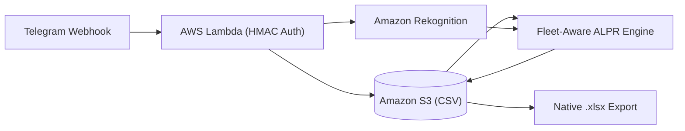

# Carvo - Serverless Fleet ALPR & Tracking Bot

[](https://github.com/onurvatansever/carvo-plaka-takip-botu/actions/workflows/ci.yml)


Serverless Automatic License Plate Recognition (ALPR) and daily wash tracking system built with AWS Lambda, Amazon Rekognition, S3, and Telegram Bot API.



## Technical Highlights (EN)

- **Fleet-Aware Fuzzy OCR:** Uses historical wash records from S3 (`yikama_takip.csv`) and a custom visual confusion matrix (`B<->8`, `D<->0`, `M<->N`, `S<->5`) to auto-correct OCR errors caused by water, foam, glare, and mounting bolts.
- **Partition Parser & Spatial Filtering:** Evaluates all valid `(province, letter, number)` splits without greedy regex bugs, merges 2-line square plates, and filters out small background/frame text using `BoundingBox.Height`.
- **Zero-Dependency `.xlsx` Builder:** Generates valid Office Open XML spreadsheets in memory using Python's standard `zipfile` module (no `pandas` or `openpyxl`).
- **Stateless Webhook Security:** Authenticates requests via constant-time `hmac.compare_digest` (`X-Telegram-Bot-Api-Secret-Token`) and handles 1-click undo/swap callbacks without external state tables.

---

## Teknik Ozet (TR)

Filo oto yikama operasyonlarinda Telegram uzerinden gonderilen arac fotograflarindan plaka okuyan, S3 uzerindeki gunluk tabloya kaydeden ve Excel (`.xlsx`) raporu ureten sunucusuz (Serverless) takip sistemi.

- **Filo Hafizali Bulanik Eslestirme:** Kopuk, parlama veya plaka vidalari yuzunden bozuk ya da eksik okunan plakalari (`34 KLN 458` veya `KLM 456`), gecmis CSV kayitlarindaki filo plakalariyla karsilastirarak otomatik duzeltir.
- **Boyut ve Alan Filtresi:** Plakalik uzerindeki telefon numaralarini ve arka plan yazilarini `BoundingBox` karakter yuksekligine gore eler; cift satirli kare plakalari destekler.
- **Harici Kutuphanesiz Excel Uretimi:** Lambda paket boyutunu kucuk tutmak icin harici kutuphane kullanmadan standart `zipfile` ile bellekte dogrudan `.xlsx` dosyasi olusturur.
- **Tek Tikla Geri Alma / Degistirme:** Kayit mesajlarinin altindaki inline butonlarla ek veritabani gerektirmeden tek tikla silme veya alternatif plakayla degistirme imkani sunar.

## Commands / Komutlar

| Command | Description |
| :--- | :--- |
| Photo | Reads the plate, matches against fleet history, and logs it for today |
| `/bugun` | Lists all vehicles washed today |
| `/excel` | Exports the full history table as an `.xlsx` file |
| `/ekle 34ABC123` | Manually adds a plate |
| `/sil` / `/sil 34ABC123` | Removes the last added plate or a specific plate from today's list |

## Tests

```bash
python -m unittest discover -s tests -v
```
