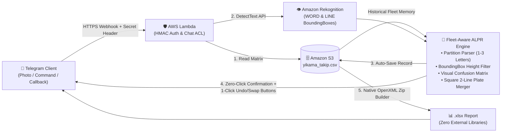

# 🚗 Carvo — Serverless Fleet ALPR & Wash Tracking Bot

[](https://github.com/onurvatansever/carvo-plaka-takip-botu/actions/workflows/ci.yml)


> **🇬🇧 English** | [🇹🇷 Türkçe](#-türkçe-proje-özeti)

A production-grade, **zero-dependency serverless Automatic License Plate Recognition (ALPR)** and fleet wash tracking system built on **AWS Lambda, Amazon Rekognition, and Amazon S3**, operated via a real-time **Telegram Bot**.

Designed for high-throughput fleet car wash operations where plates are frequently obscured by **water droplets, foam, mounting bolts, glare, and steep camera angles**.

---

## 🏗️ System Architecture



---

## ✨ Key Engineering Highlights

### 1. 🧠 Fleet-Aware Fuzzy OCR Engine (Self-Correcting Recognition)
General-purpose scene text OCR models often misread characters on wet or bolted license plates (e.g., `B ↔ 8`, `D ↔ 0`, `M ↔ N`, `S ↔ 5`, `I ↔ 1`) or miss the province prefix (`34`) due to foam/glare.
* **Historical Fleet Memory:** On each invocation, the engine extracts the frequency distribution of all previously serviced fleet vehicles from S3 (`yikama_takip.csv`) in a single read.
* **Visual Confusion Distance Matrix:** Candidates are scored against known fleet plates using a custom visual confusion matrix (`GORSEL_BENZERLER`). If `34 KLM 456` is misread as `34 KLN 458` or partially read as `KLM 456`, it automatically snaps to the verified fleet plate while protecting sequential fleet series (e.g., `34 PRS 101` vs `34 PRS 102`).

### 2. 📐 Partition-Based Parser & Spatial Bounding-Box Scoring
* **Anti-Greedy Partitioning:** Unlike naive regular expressions where `[A-Z0-9]{1,3}` greedily consumes trailing digits on unspaced plates (turning `34AB1234` into `34 ABI 234`), the parser evaluates all valid `(il, harf, sayi)` partitions and enforces token-boundary alignment.
* **Bolt & Euroband Noise Tolerance:** Strips `.TR` rivet artifacts, black mounting bolts between `34` and the letter group (`34 • PBD 510`), and dealer phone numbers (`444 ...`, `0212 ...`) printed on the license plate frame.
* **Relative Font-Height Filtering:** Uses `BoundingBox.Height` ratios to prioritize primary license plate characters over small-print advertisements on plate holders or distant garage pillar signs (`A89`, `A91`).
* **2-Line Square Plate Support:** Vertically merges horizontally aligned `WORD` bounding boxes for square/motorcycle plates.

### 3. 📦 Zero-Dependency In-Memory `.xlsx` Generator
To keep the AWS Lambda deployment package at **< 15 KB** and eliminate cold-start overhead, `matris_to_xlsx()` constructs a valid **Office Open XML (`.xlsx`)** spreadsheet directly in memory using only Python's standard `zipfile` and `io.BytesIO` modules—requiring **no `pandas` or `openpyxl` layers**.

### 4. 🔒 Security-First Webhook Design
* **Constant-Time Secret Verification:** Every request is authenticated via `hmac.compare_digest` against `X-Telegram-Bot-Api-Secret-Token` before JSON parsing.
* **Strict Chat ACL:** All state-changing operations require membership in `ALLOWED_CHAT_IDS`.
* **Stateless 1-Click Undo / Swap UX:** Records are saved immediately (zero-click workflow), accompanied by stateless inline keyboard callbacks (`sil:<plate>` and `degistir:<old>:<new>`) that fit within Telegram's 64-byte `callback_data` payload—eliminating the need for DynamoDB state tables.

---

## 🧪 Running Unit Tests

The test suite runs with **zero external dependencies** (mocking `boto3` automatically when run locally or in CI):

```bash
python -m unittest discover -s tests -v
```

---

## 🇹🇷 Türkçe Proje Özeti

**Carvo Plaka Takip Botu**, filo oto yıkama operasyonlarında araç plakalarını **Telegram** üzerinden gönderilen fotoğraflardan otomatik olarak okuyan, doğrulayan ve **Amazon S3** üzerinde tutulan günlük/tarihsel tabloya kaydedip tek komutla **Excel (`.xlsx`)** raporu üreten sunucusuz (Serverless) bir sistemdir.

### Çözülen Teknik Problemler
* **Filo Hafızalı Bulanık Eşleştirme (Fuzzy Matching):** Islaklık, köpük, parlama veya plaka vidaları nedeniyle `34 KLM 456` plakası `34 KLN 458` veya eksik olarak `KLM 456` okunsa bile geçmiş yıkama veritabanı (`yikama_takip.csv`) üzerinden görsel benzerlik matrisiyle gerçek filo plakasına tamamlanır.
* **Vida, Mavi Şerit (`TR`) ve Plakalık Filtresi:** `34` ile harf grubu arasındaki siyah vidaları, `.TR` perçin izlerini, otopark kolon yazılarını (`A89`, `A91`) ve plakalık üzerindeki telefon numaralarını (`444 ...`, `0212 ...`) `BoundingBox` karakter yüksekliği ve bölümleme (partition) algoritmasıyla filtreler.
* **Sıfır Tıklama + Tek Tıkla Geri Al / Değiştir:** Fotoğraf gönderildiğinde plaka doğrudan kaydedilir; mesajın altında çıkan **`[ 🗑️ Yanlışsa Sil ]`** ve **`[ 🔄 Alternatif Yap ]`** butonları sayesinde hiçbir ek veritabanı (DynamoDB vb.) kullanmadan tek tıkla düzeltme yapılır.
* **Harici Kütüphanesiz `.xlsx` Üretimi:** Lambda paket boyutunu büyütmemek için `openpyxl` veya `pandas` kullanmadan Python standart `zipfile` kütüphanesiyle bellekte doğrudan Excel dosyası oluşturulur.

### 🤖 Bot Komutları
| Komut / İşlem | Açıklama |
| :--- | :--- |
| 📸 **Fotoğraf Gönderimi** | Plakayı otomatik okur, filo hafızasıyla doğrular ve bugünün sütununa kaydeder. |
| `/bugun` | Bugün yıkanan tüm araçları ve toplam araç sayısını listeler. |
| `/excel` | Tüm günlerin yıkama tablosunu `.xlsx` (Excel) dosyası olarak sohbete gönderir. |
| `/ekle 34ABC123` | Manuel plaka ekler (`/ekle ABC123` yazılırsa başına otomatik `34` ekler). |
| `/sil` veya `/sil 34ABC123` | En son eklenen plakayı veya belirtilen plakayı bugünün listesinden siler. |
| `/id` | Kurulum aşamasında sohbetin `Chat ID` bilgisini verir. |

### ⚙️ Kurulum ve Dağıtım (AWS SAM / Lambda)
1. `.env.example` dosyasındaki ortam değişkenlerini (`TELEGRAM_TOKEN`, `TELEGRAM_WEBHOOK_SECRET`, `S3_BUCKET`, `ALLOWED_CHAT_IDS`) AWS Lambda **Environment Variables** bölümüne tanımlayın.
2. `template.yaml` ile AWS SAM üzerinden (`sam build && sam deploy --guided`) veya doğrudan `lambda_function.py` dosyasını AWS Lambda konsoluna yükleyerek dağıtımı tamamlayın.
